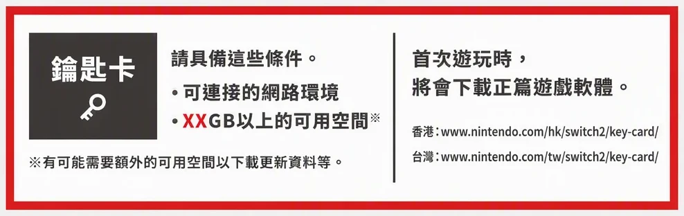

> 本文最后更新日期：2026-11-12

同一个游戏，卡带和数字版的实际花费能差一半。

## ⚖️ 六个维度对比

| 维度 | 实体卡带 | 数字版 |
|---|---|---|
| 首次购买价 | 通常贵一些 | 打折时可能更低 |
| 能否转卖 | ✅ 可以，玩完能回血 | ❌ 不能 |
| 占用存储 | 少（多数游戏卡带即插即玩） | 多（一个 3A 十几到二十几 GB） |
| 加载速度 | 略慢（受卡带读取限制） | 略快 |
| 丢失/损坏风险 | 有（卡带小、易丢） | 无（绑账号） |
| 共享 | 可以借给朋友 | 同一账号的主机之间可共享 |

玩完会出掉，买卡带；打算长期留着，等数字版打折。

## 💿 钥匙卡（Key Card）为什么特殊

Switch 2 引入了「钥匙卡」这种形态：盒子里只有一把钥匙，游戏本体需要联网下载。

影响到的地方很具体：

- 二手转卖价值降低——买家拿到手还得下一遍，跟买数字版差别不大
- 断网/停服环境下可能玩不了
- 买二手卡带时一定要看清是不是钥匙卡，价格应该明显低于实体完整卡带

判断方法：看盒面标识，或直接问卖家「是完整卡带还是钥匙卡」。

## 💰 怎么买最省

| 你的情况 | 建议 |
|---|---|
| 通关一次就不玩了 | 买二手卡带，玩完原价或折价出掉 |
| 长期反复玩（联机、派对类） | 数字版等打折，省得换卡 |
| 收藏党 | 首发光盘/卡带，保值性看作品 |
| 想和家里人共用 | 卡带最直接，插上就能玩 |
| 存储卡容量紧张 | 优先卡带，减少下载 |

## 🌍 换区买能省多少

同一个数字版游戏，在不同区的 eShop 定价可能差不少。换区购买是官方允许的设置，不是破解，但要注意余额和语言问题，详见 [eShop 换区攻略](/switch/games/eshop-region/)。

## ✅ 三条实用建议

1. 宁可买二手卡带，也别买「共享账号」——账号共享违反任天堂条款，有封号风险
2. 数字版只在自己账号买，别贪便宜买第三方账号或兑换码
3. 主机存储别塞满，留出余量，更新补丁也需要空间

## 🔗 相关阅读

- [eShop 换区攻略](/switch/games/eshop-region/)
- [Switch 必买游戏清单](/switch/games/best/)
- [microSD Express 存储卡怎么选](/switch/gen-2/microsd/)
