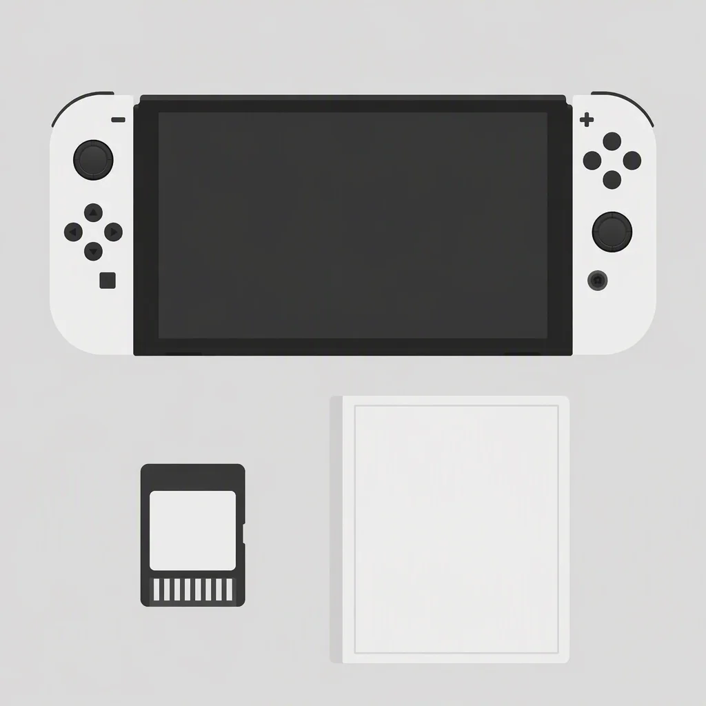

> 本文最后更新日期：2026-11-12

**胖黄鸭的立场：明确反对任何形式的 Switch 破解与盗版。** 本站不提供破解教程、不提供任何工具或软件下载、不推荐改装商家，也不接相关商业合作。本文只做一件事——把「switch 破解」到底意味着什么、要付出什么代价讲清楚，免得你被「免费玩游戏」这句话忽悠。

如果你找的是操作步骤，这里没有，也不会有。下面每一条都是风险，不是心得。

---

## ⚖️ 先说结论：省下的几百块，可能赔掉一台机器

愿意花时间折腾破解的人，图的无非是省下游戏钱。但把账摊开算：

- **封号**：破解机联网就可能被识别，一旦封禁，eShop、联机、云存档一起失效；
- **丧失联网玩法**：马车、大乱斗、喷喷、动森的精髓全在联机，破解机等于自断一臂；
- **官方服务归零**：系统更新、DLC、售后都不再正常；
- **维护成本高**：自制系统要跟着官方系统不断跟进，出错就是自己的机器；
- **法律与道德风险**：破解与传播盗版在多数地区违法，国内外都有判例。

**省下的是几百块游戏钱，搭进去的是一台机器的完整体验。** 这笔账怎么算都不划算，这也是本文唯一的结论。

---

## 🔓 Switch 破解是什么？（只说存在什么，不说怎么做）

所谓「破解」（crack，也叫 jailbreak），指的是绕过任天堂官方的启动与验证机制，在机器上运行未经授权的自制系统，从而安装非官方渠道的游戏。

市面上流传的做法，大致可归为两类：

| 类型 | 大致是什么 | 卡在哪 |
|---|---|---|
| 软件漏洞类（俗称软破） | 利用早期机型硬件层面的漏洞，在开机阶段绕过官方引导流程 | 漏洞只存在于早期一批初代机，官方在后续机型中已修复 |
| 硬件焊接类（俗称硬破） | 拆机在主板上加装第三方芯片，强制改变启动流程 | 必须拆机焊接，失去保修，焊坏即报废 |

两者最终都指向同一件事：**跳过正版验证，运行盗版游戏**。具体手段本文不写、不教、也不作任何推荐——这不是「留一手」，而是这类操作本身违法且高风险，讲清楚代价才是负责。

:::caution[⚠️ 本站不做的事]
不提供破解教程、不提供工具下载、不提供改机商家信息、不解答「怎么破」之类的问题。看到正文里出现具体的接线、引导、焊接步骤，就该警惕——那是教程，不是科普。
:::

---

## 🔍 Switch OLED 能软破吗？为什么只能硬破

**不能。Switch OLED 不存在可用的软件破解路线。**

早期那批初代机之所以能被软破，是因为所用芯片在启动阶段存在硬件层面的漏洞。任天堂在后续机型（续航版、OLED、Lite）上统一更换了修复该问题的芯片方案，**官方早已封堵**。所以：

- 网上搜到的「switch oled 软破」「OLED 破解不用拆机」，多数是**把机型搞混了**——能软破的是早期初代，不是 OLED；
- 另一种是**把拆机改装包装成「软破」在卖**，本质仍是硬破，且大概率已经被 ban；
- 还有一部分纯粹是**引流**，点进去拿不到任何真东西。

真正能落在 OLED 上的只有硬破，而 OLED 恰好是最不划算的一台：拆机费用更高、屏幕与排线更脆、失去官方保修、机身被动过之后二手也难出。**「switch oled 破解」这条路存在，但门槛、风险、翻车概率都是全系最高的。**

---

## 🚫 Switch 破解会被封号吗？封了会失去什么

会。这是破解最确定、最不可逆的代价。

任天堂在官方使用条款中明确禁止对主机进行未经授权的改装与绕过（[国行使用条款](https://www.nintendoswitch.com.cn/policy/device.html)），并对违规账号与设备采取封禁措施；近期条款更新后，对「篡改主机」的处理口径进一步收紧（[相关报道](https://www.ithome.com/0/851/778.htm)）。

一旦被封，失去的是：

- **eShop**——买不了游戏、领不了会免、下不了 DLC；
- **联机**——所有需要联网的玩法直接断掉；
- **云存档**——存档只留在本机，机器一坏就全没了；
- **系统更新与售后**——出问题只能自己扛。

---

## 🧱 Switch 破解会「变砖」吗？

「变砖」是民间术语，但风险是真实的：拆机焊接本身就可能损坏主板；自制系统与官方系统版本不匹配、更新时误操作，也可能让机器无法正常启动。这类损坏通常不在保修范围内，维修费用往往接近半台机器。

**换句话说：即使不谈封号，破解也是一项「可能把机器搞坏」的操作。**

---

## 🔌 破解之后还能更新系统、还能联机吗？

不能正常用。

- **更新**：官方更新会检测系统完整性，破解机更新后轻则失效、重则无法开机，只能等第三方跟进；
- **联机**：一联网就有被识别与封禁的风险，等于把主机降级成一台离线单机；
- **新游戏**：还得等第三方适配，热门新作往往要等上一段时间。

---

## 🧼 破解机能「洗白」回正版吗？有残留风险吗

不保证，也不建议赌。

即使恢复官方系统，设备此前联网留下的记录、硬件层面的改动痕迹都可能仍然存在。**买二手 Switch 时，「卖家说已经洗白」不能当作安全凭证**——最稳妥的做法是当面验证能否正常登录 eShop、能否正常更新系统。

---

## 🔎 二手 Switch 怎么看出是不是破解机

这是破解话题里**最值得花时间**的一节：与其研究怎么破解，不如学会怎么不被坑。二手市场里「已经改过的机器」比想象中多，买到黑机的代价是被连带封禁。

- 让卖家**当面登录 eShop**，能正常进商店、能正常下载免费内容，才算基本过关；
- 检查系统里是否出现**官方渠道之外的应用或商店**；
- 询问是否做过**硬件改装**，机身螺丝、封条、拆机痕迹都要看；
- 价格明显低于行情、卖家反复强调「不用管系统」的，一律谨慎。

完整的验机流程和型号挑选建议，写在 [Switch 一代选购指南](/switch/gen-1/guide/) 里。

---

## 📉 为什么以前破解的人多，现在越来越少了？

如果你在 2019 年前后关注过 Switch，会发现当时「破解」话题很热闹，现在却明显冷清。原因主要有这几个：

1. **能破的机器没了**。可软破的早期初代机早已停产多年，存量机器陆续进入报废期，官方也在后续机型上封堵了漏洞——「无米下锅」是最直接的原因。
2. **硬改门槛高、风险大**。拆机焊接不是普通玩家敢碰的，焊坏就报废，还得付手工费。
3. **封号代价越来越重**。从封账号、封设备，到条款口径收紧，风险门槛一年比一年高。
4. **联网时代破解失去大半价值**。游戏越来越依赖联网，破解机一联网就面临封禁，等于自我阉割。
5. **正版获取成本在下降**。eShop 常年打折、实体卡带二手流通成熟还能回血，正版的价格痛点已经没那么痛。
6. **官方打击持续升级**。从起诉破解团伙核心成员并判刑（[Team Xecuter 案件](https://en.wikipedia.org/wiki/Team_Xecuter)），到条款收紧，破解的供给端也在萎缩。

---

## ⚠️ 常见传言，逐条打假

**「软破可逆，删掉就没事了」**
可逆是指机器能恢复原状，不代表你的账号和设备没被记录。风险不在系统里，在联网行为里。

**「不联网就查不到」**
只要你后来联机、更新，或者把机器转卖给别人，历史行为就可能暴露。二手交易恰恰是最容易出事的环节。

**「破解不影响联机」**
正相反，联机是最先失去的功能。想联机就得回官方系统，而回官方也不保证解封。

**「OLED 可以软破，只是方法没公开」**
纯属机型混淆。OLED 用的是修复后的芯片，软件路子不存在。

**「破解机能洗白，卖家说洗过了」**
不保证，且无法验证。买二手请按上一节的验机流程走。

---

## 🧪 顺带一提：技术在变，判断标准没变

最近「Switch 游戏被搬到手机上跑」的新闻很多，背后是 ARM 同架构与 AI 辅助逆向把门槛砍低了。技术本身谈不上善恶，值得弄清原理，但不值得替它传播破解资源——详细的技术拆解见 [Switch 游戏为什么能跑在手机上](/switch/tech/ai-porting/)。

## ✅ 最后：支持正版，才是对游戏最好的支持

破解看似「省钱」，实则是用一台机器的完整体验、账号安全和联机乐趣，去换短暂的免费快感，长远看一定是亏的。胖黄鸭作为游戏机选购指南，**始终反对任何形式的破解**。

如果你只是担心正版游戏太贵，其实有大量合法又省钱的玩法：

- 蹲 **eShop 打折**；
- 买**二手实体卡带**，玩完再出掉回血，实际成本可能只有原价三成；
- 和好友**合购家庭会员**，Nintendo Switch Online 年费摊下来很便宜；
- 关注各区 eShop 定价差异，换区购买并不违反条款。

**支持正版，才能真正支持你喜欢的游戏和厂商。** 这也是胖黄鸭一直以来的立场。

---

:::tip[💡 相关阅读]
- 想正常入手一台 Switch：[Switch 一代选购指南](/switch/gen-1/guide/)，四型号区别、优缺点、二手验机一次讲清
- 想了解二代：[Switch 2 选购指南](/switch/gen-2/guide/)，以及「Switch 2 现在破解了吗」
- 限定机值不值得买：[Switch 2 限定机图鉴](/switch/gen-2/gen2-limited/)
:::
