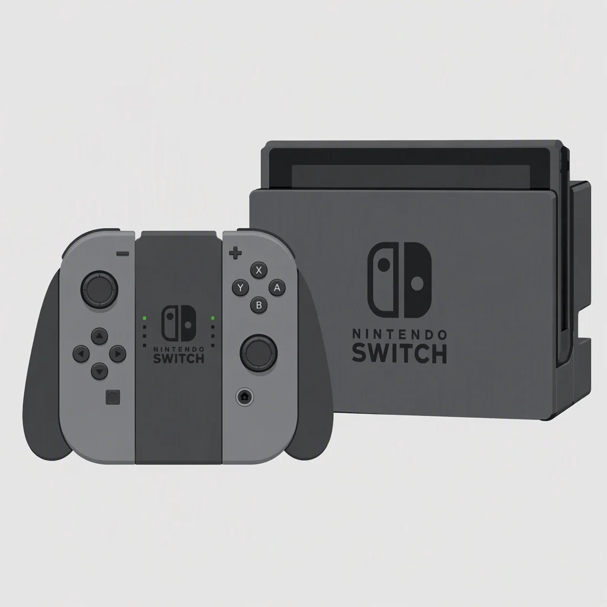
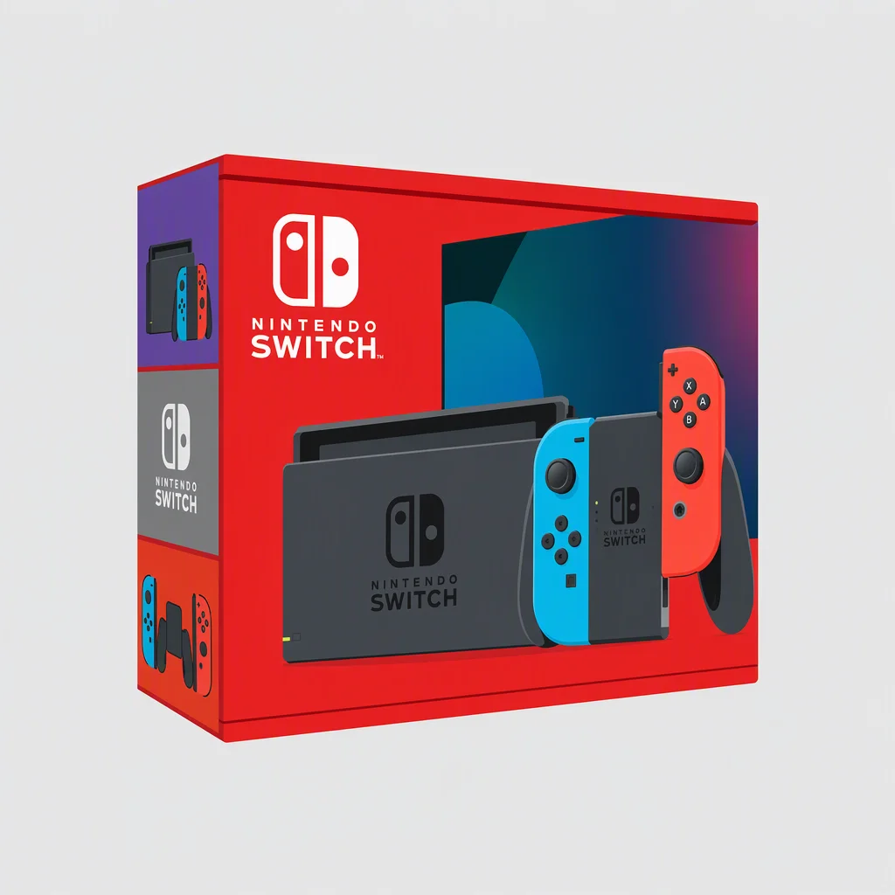
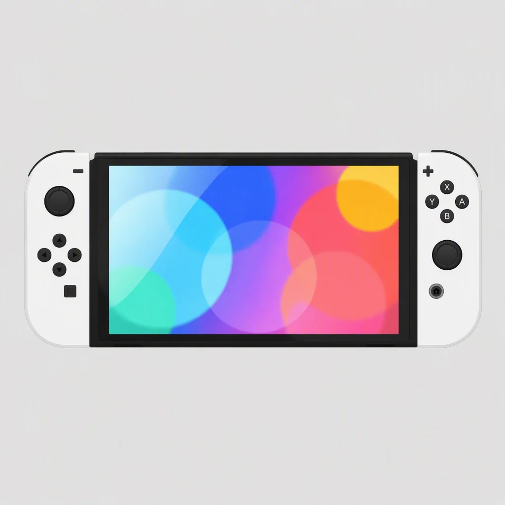
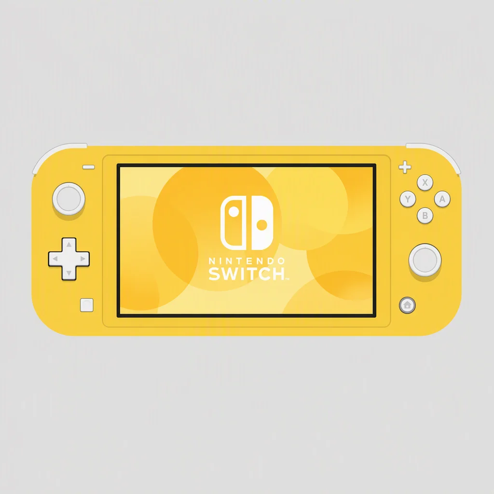

> 本文最后更新日期：2026-08-02

**预算有限、主要玩既有 Switch 游戏 → 选初代；追求性能和新作 → 上 Switch 2。**

本文梳理初代四个型号的区别，帮你快速判断哪个值得买。还没想好买一代还是二代？先看 [一代和二代区别对比](/switch/compare/)。

## 1. Nintendo Switch 初代

- **发售时间**：2017 年 3 月
- **状态**：🚫 已停产

最初的 Switch 机型。搭载 Tegra X1 芯片，存在[硬件级漏洞，破解机在二手市场要特别留意](/switch/gen-1/gen1-jailbreak/)，电池续航约 2.5~6.5 小时。很快被后续型号替代。**不推荐购买二手初代**，除非收藏。

## 2. Nintendo Switch 续航版

- **发售时间**：2019 年 8 月
- **状态**：⚠️ 逐步退市（Switch 2 发布后一代全系减产）

核心升级是换用了 **Mariko 芯片**（Tegra X1+），制程从 20nm 升级到 16nm：

- 🔋 **续航大幅增强**：约 4.5~9 小时，比初代提升近 50%
- 🔒 **修复硬件漏洞**：初代的 RCM 漏洞被封堵

其余与初代完全一致（6.2 寸 LCD 屏幕、同款 Joy-Con）。续航版采用**全红色包装**，是**一代里性价比最高的型号**。二手市场仍有大量流通。

:::tip[选购建议]
预算有限、主要连电视玩的玩家，续航版二手是当前最优解。价格实惠，游戏库完整。
:::

## 3. Nintendo Switch OLED

- **发售时间**：2021 年 10 月
- **状态**：⚠️ 逐步退市（一代最终旗舰）

OLED 版是续航版的"上位替代"，被誉为**一代机里的最终形态**：

- 📱 **7 寸 OLED 屏幕**：色彩鲜艳、黑色更深，掌机体验质的飞跃
- 🗄️ **存储翻倍**：64GB（续航版为 32GB）
- 🦵 **全新支架**：全尺寸可调，桌面模式大幅改善
- 🔊 **增强扬声器**
- 🌐 **底座新增网口**

性能与续航版相同，升级全在外围体验上。OLED 采用**竖版包装，独占白色 Joy-Con**。**掌机玩家闭眼入 OLED**。

## 4. Nintendo Switch Lite

- **发售时间**：2019 年 9 月
- **状态**：✅ 在售（欧洲 2026 年因欧盟法规停售，北美/日本仍可购买）

Switch 家族中**唯一的纯掌机**，砍掉了 TV 输出和可拆卸手柄：

- 🪶 **轻便小巧**：仅 275g，携带无压力
- 🎨 **多彩配色**：糖果色机身选择丰富
- 🎮 **一体式十字键**：手感优于 Joy-Con 分体按键
- 💰 **价格最低**（全新约 ¥1,000 左右，二手更低）

:::caution[注意]
不能连电视，手柄不可拆卸，部分体感游戏（如健身环大冒险）无法游玩。适合纯掌机玩家或作为第二台 Switch。
:::

---

## 🔧 老机器的常见故障

一代机型普遍已服役多年，**摇杆漂移和电池衰减**是最常见的两个问题，买二手或打算继续用时值得先了解维修成本，见 [Switch 常见故障与维修](/switch/repair/)。

## ⚠️ 特别注意：国行 Switch

国行版由腾讯代理，但**网络服务已于 2026 年 5 月 15 日全面停止**（eShop 下载、兑换、联机、系统更新全部终止），2026 年 12 月 31 日后连主机与配件维修服务也会结束。现在买国行，等于买一台只能离线玩卡带的机器。

二手市场常有低价国行机混卖，认准包装盒右上角的蓝色「国行正品」标志：

各版本（国行 / 港版 / 日版 / 美版）的 eShop、语言、插头与保修完整对比，见 [区域与版本](/switch/region/)。
