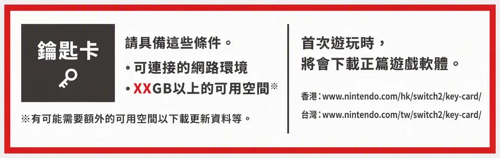

> 本文最后更新日期：2026-08-17

选购 Switch 2 时最容易踩坑的问题，集中在这里解答，会持续补充。

---

## 🛒 该买哪个版本？日版 / 港版 / 国际版怎么选？

**Q：该买哪个版本？日版、港版、国际版怎么选？**

**A：** 一句话：**首选港版或国际版**，系统语言可选、eShop 可自由切换区域，付款也方便。

- 🇭🇰 **港版 / 国际版**：推荐。语言可切换，eShop 可跨区购买
- 🇯🇵 **日版**：普通日版与国际版规格一致，但要警惕「日本国内専用」特供机（锁日文、锁日区商店），别贪便宜买错（见下一条）
- 🇨🇳 **国行**：Switch 2 **没有国行**，市面上自称「国行 Switch 2」的一律按骗局处理

各版本的 eShop、语言、插头与保修完整对比，见 [区域与版本](/switch/region/)。

---

## ⚠️ 为什么不推荐买日本限定版？

**Q：为什么不推荐买日本限定版？我不介意界面是日语**

**A：** 除了锁操作界面为日语以外，还会限制仅能用日语商店、以及只能和地区设定为日本的机器联机；甚至很多多语言的游戏，由于系统锁日语，进入游戏后也无法调整为日语以外的语言。

---

## 🔄 向下兼容吗？一代的卡带和数字游戏还能玩吗？

**Q：Switch 2 向下兼容吗？我一代的卡带和数字游戏还能玩吗？**

**A：** 兼容。一代的实体卡带（黑色）可以直接插进 Switch 2 游玩，eShop 里已购买的数字游戏也能重新下载，部分一代游戏还会获得性能强化（更流畅、加载更快）。

反过来不行：Switch 2 的红色卡带和 Switch 2 专属新作，一代机器**无法运行**。

---

## 🔑 什么是钥匙卡？

**Q：什么是钥匙卡？**

**A：** Switch 2 部分实体卡带是「钥匙卡」——卡带本身不含游戏数据，仅作为验证凭证，插入后仍需下载完整游戏到机身存储。可以理解为「数字版 + 实体凭证」的结合：喜欢实体收藏的玩家能拿到盒子和卡带，但游戏本体依然要占机身存储空间。

包装盒下半部分会有如下标识（如图）：

因为钥匙卡 + 数字版游戏都要占用机身存储，256GB 可能不够用，重度玩家需要额外扩容（扩容卡的选择见下一条）。

---

## 💾 存储卡：256GB 够吗？为什么读不了一代的卡？

**Q：256GB 机身存储够用吗？为什么读不了一代的 microSD？**

**A：** 只玩实体卡带的玩家够用；偏数字版或买了不少钥匙卡的会吃紧。

一代的 microSD 读不出来，是因为 Switch 2 卡槽只支持 **microSD Express** 新规格，普通 microSD（UHS-I）协议不同，插进去也不会被识别。

容量怎么选、买哪个牌子、怎么防假卡，见 [microSD Express 存储卡怎么选](/switch/gen-2/microsd/)。

---

## 🎒 需要买哪些配件？

**Q：需要额外买哪些配件？贴膜、收纳包、手柄有必要吗？**

**A：** 盒内已附带主机、Joy-Con 2、底座、AC 适配器 + USB-C 线、HDMI 线、腕带与握把，这些不用另买。

额外最值得补的三件是：**钢化膜、microSD Express 存储卡、收纳包**；Pro 手柄和额外 Joy-Con 2 按需。完整清单与预算分配见 [Switch 2 配件必买清单](/switch/gen-2/accessories/)。

⚠️ 注意：一代的 AC 适配器、HDMI 线、底座**不能用在 Switch 2 上**（底座插不进去、适配器供电不足无法输出画面），请务必使用随附的配件。

---

## 📺 普通电视能玩吗？需要买 4K 电视吗？

**Q：普通电视能玩吗？需要专门买 4K 电视吗？**

**A：** 有 HDMI 口的普通电视就能玩，只是享受不到最佳画质。Switch 2 底座模式最高支持 4K 60Hz（部分游戏），想跑满 4K / 120Hz / HDR 需要电视支持 HDMI 2.1。

1080p 的老电视一样能正常玩，画面只是没有 4K 那么细腻，**不需要为了 Switch 2 专门换 4K 电视**——除非你本来就打算换。掌机模式下 7.9 寸屏是 1080p 120Hz，本身就很清晰。

---

## 🌐 联机、语音聊天需要 Nintendo Switch Online 会员吗？

**Q：联机对战、语音聊天需要 Nintendo Switch Online 会员吗？**

**A：** 需要。和其他主机一样，Switch 2 的**在线联机对战需要 Nintendo Switch Online（NSO）会员**。

- 💬 **GameChat 语音聊天**：也需要 NSO 会员（之前有过免费试用期，2026 年 3 月 31 日已结束），并且需要 Nintendo Account 通过手机号短信验证。
- 📥 **下载数字游戏、更新系统**：不需要会员。
- ☁️ **云存档**：需要会员。

简单记：**不联机就无所谓，要联网对战 / 语音 / 云存档就得开会员**。

---

:::tip[💡 相关阅读]
版本选择、日版特供机的识别、钥匙卡、涨价信息等更详细内容，详见 [Nintendo Switch 2 选购指南](/switch/gen-2/guide/)。
:::
