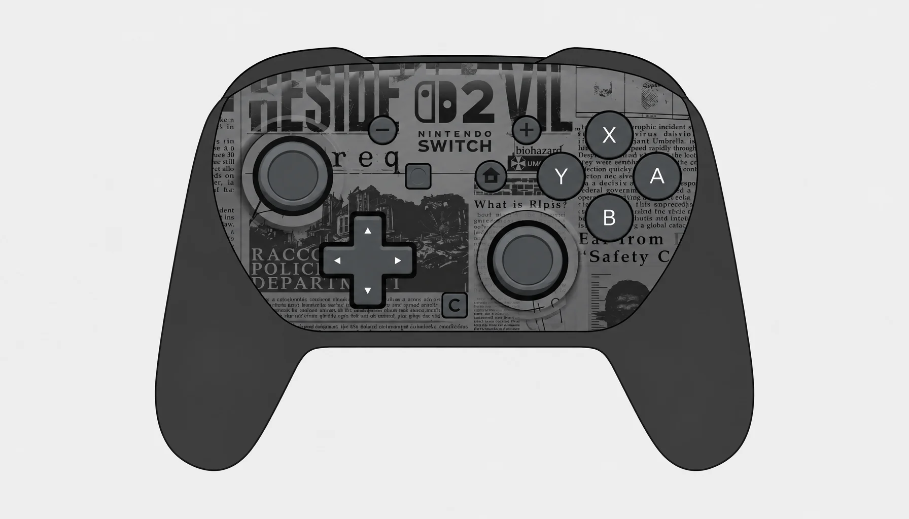
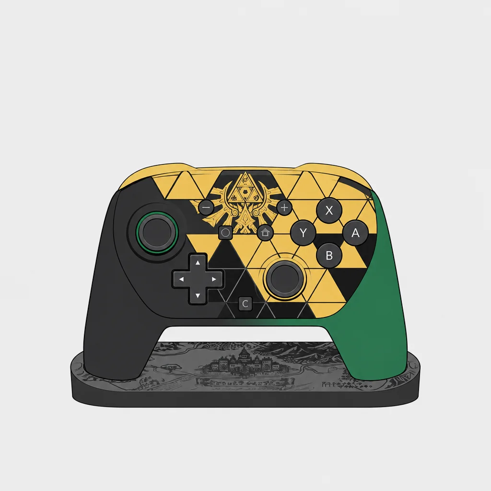

> 本文最后更新日期：2026-11-12

Switch 2 上市一年多，官方特别设计的 Pro 手柄目前只出了两款。本文持续收录。

---

## 🧟 生化危机：安魂曲 版

2026 年 2 月 27 日与《生化危机：安魂曲》同日发售，是 Switch 2 **首款特别设计的 Pro 手柄**。握把是黑灰哑光，面板整块做成报纸拼贴：浣熊市警察局报头、保护伞公司标志、biohazard 字样，还有密密麻麻的剪报正文，凑近能真的读出字来，细节相当用心。

---

## 🟢 塞尔达传说 40 周年 版

2026 年 10 月 29 日与纪念版主机同日发售，附一个展示支架，支架上还压着城堡浮雕。本体是金黑三角纹铺满面板，正中印海拉尔纹章，左右握把一边黑一边墨绿——绿色那只恰好压住三角纹的收边，配色比想象中克制，摆柜很好看。

---

:::tip[💡 购买提示]
两款限定版的功能和普通 Pro 手柄完全一致，差价买的全是外观：生化危机款胜在图案细节，塞尔达款多了展示支架。另外 Pro 手柄的仿品一直不少，建议走官方渠道，收二手时留意序列号。
:::
