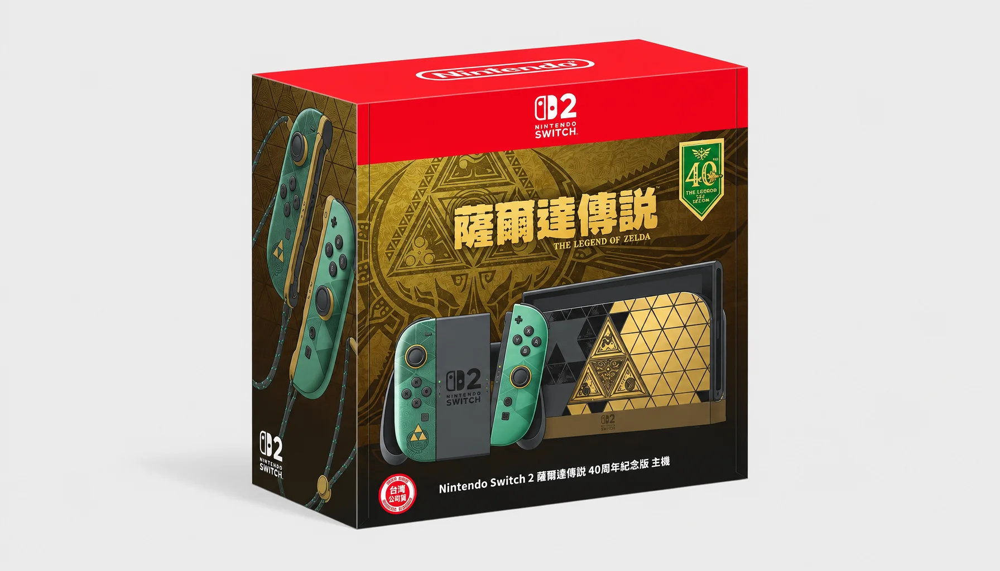
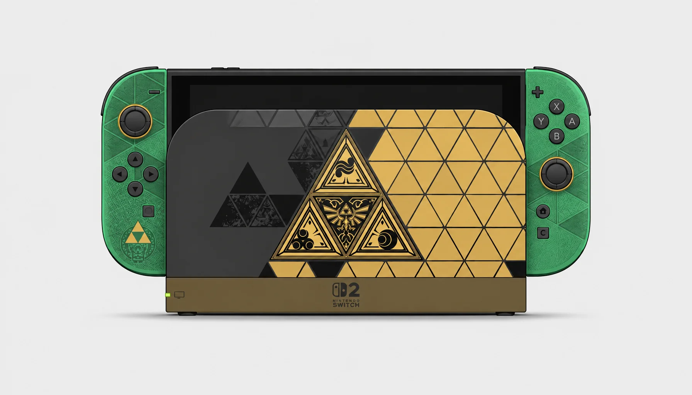
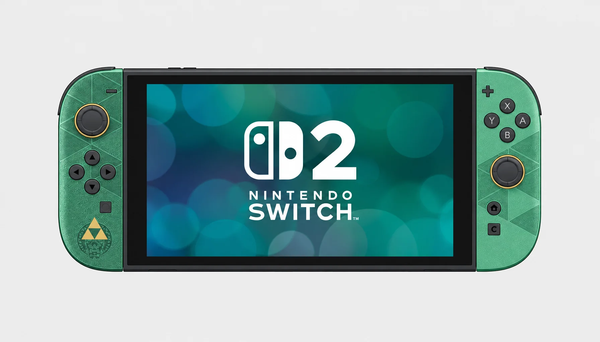

> 本文最后更新日期：2026-11-12

Switch 2 上市至今，整机外观重新设计的限定机只有一台。本文持续收录。

---

## 🟢🟡 塞尔达传说 40 周年纪念版

2026 年 10 月 29 日发售，是 Switch 2 首款本体、Joy-Con 2、底座全部特别设计的限定机。深绿配金色三角力量纹样，图案里还藏着像素风的小林克和小塞尔达。

日版 ¥62,980（锁日文）、港版 HKD 3,850、美版 $519.99、韩版 ₩788,000、澳版 A$799。包装里不含游戏，《时之笛》重制版要另外买。

---

:::tip[💡 收藏建议]
Switch 2 目前的真限定只有这一台，官方商店开订即售罄。马车世界、宝可梦 Z-A、Splatoon Raiders 那些"限定套装"机身都是普通款，只有盒子是定制印刷，收藏意义不大。日版锁日文，想收建议选港版。
:::
