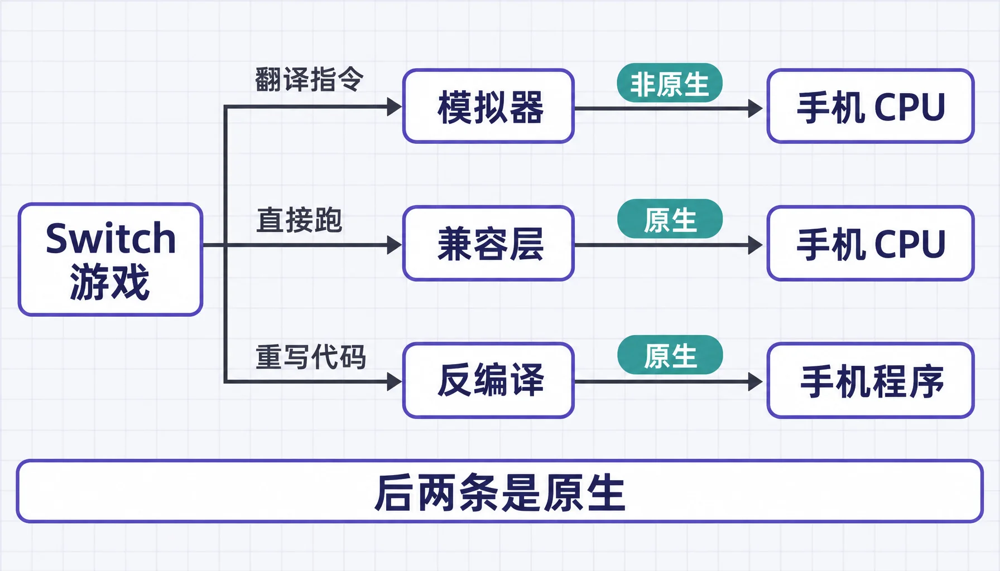
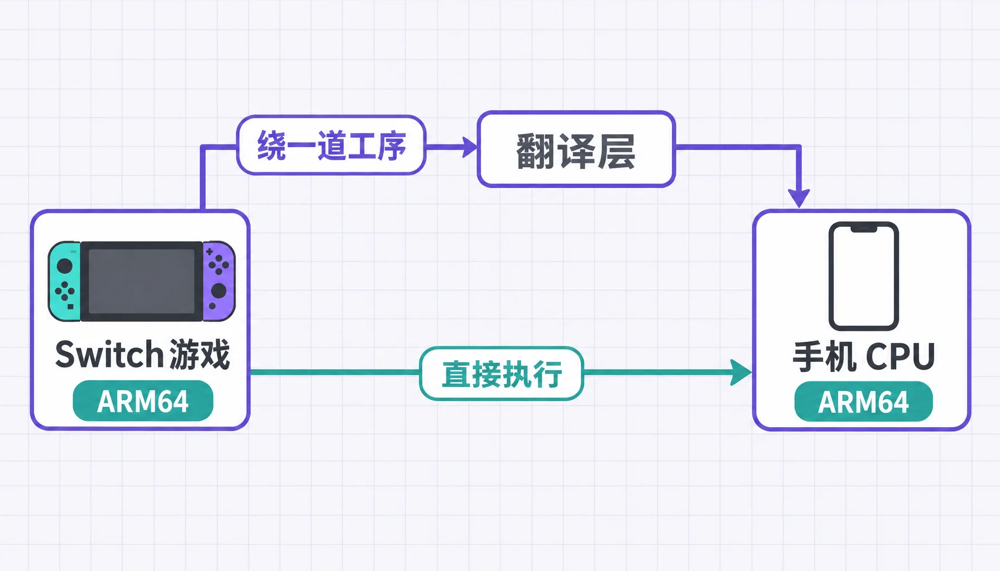
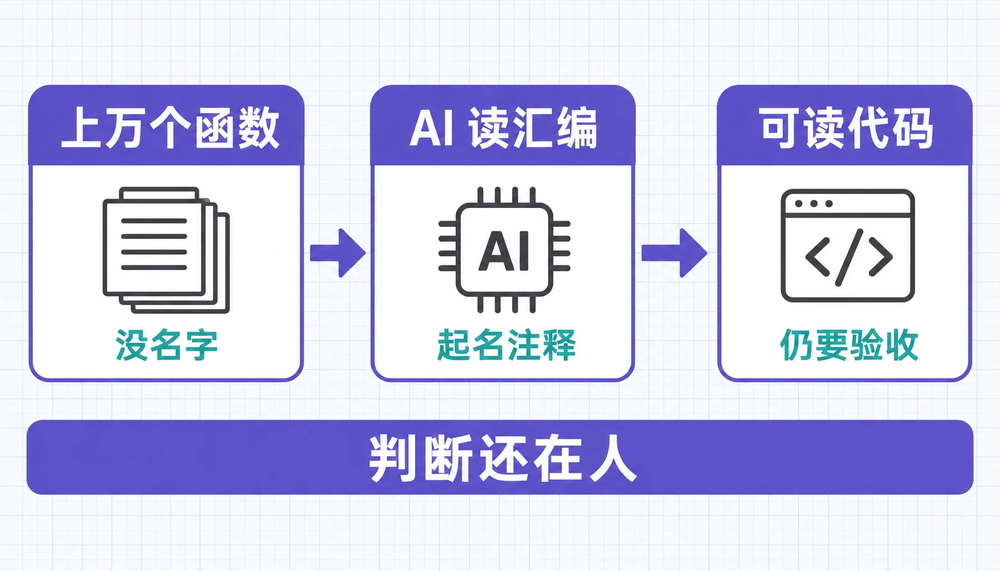
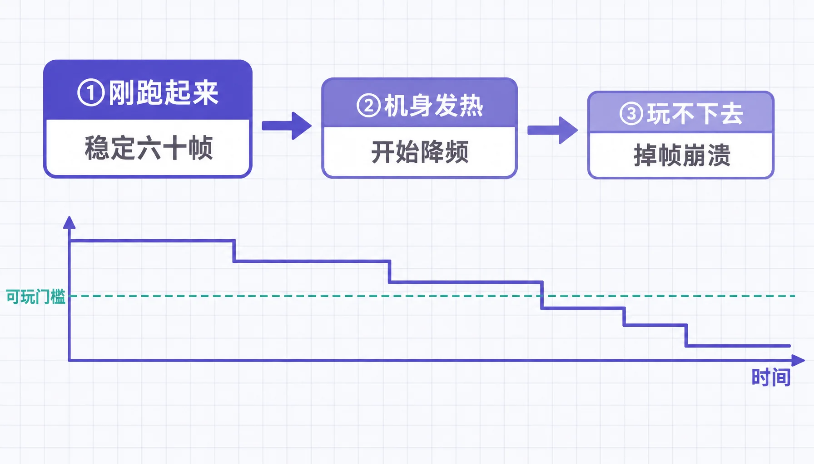
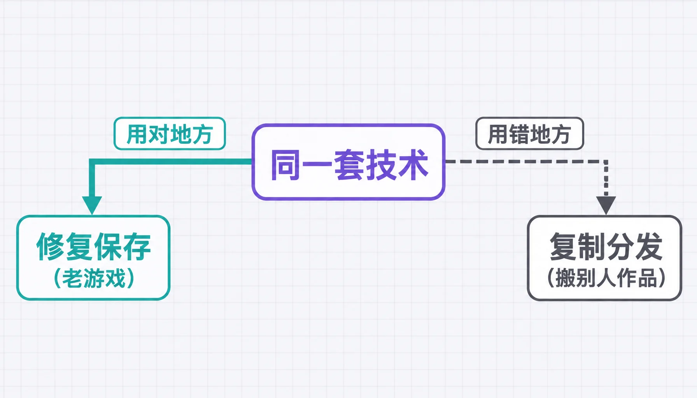

> 本文最后更新日期：2026-11-12

十月的时候，安卓圈子里有个不太寻常的景象：一群人在骁龙手机上玩《暗黑破坏神 2》，帧数还挺稳；另一些人把《马力欧》塞进了 iPhone；还有人在安卓掌机上跑起了《塞尔达》。

这些都不是模拟器的截图。跑起来的是游戏自己的 ARM64 代码，直接落在手机的 CPU 上。

怎么做到的，值得说清楚。至于工具、仓库和操作步骤，本文一个都不写，理由放在最后。

## 🔍 三条路，别混着谈

「把主机游戏搬上手机」这句话里藏着三种做法，难度和风险差得远。

| 路线 | 做法（本质） | 原生 |
|---|---|---|
| 模拟器 | 在手机上重建一台「虚拟 Switch」，逐条翻译 CPU 指令与图形调用（软件仿真） | ❌ |
| 兼容层 | 游戏自己的 ARM64 代码直接跑，只把系统服务换成手机侧替身（系统层适配） | ✅ |
| 反编译重编译 | 反编译成可读代码，再重新编译到新平台（回到源码级） | ✅ |

新闻里被讨论的，基本都是后两条。它们能成立，靠的是同一个前提：CPU 那一关被跳过了。

## 🧩 手机这次占了架构的便宜

Switch 里面是 NVIDIA 的 Tegra X1，四核 ARM Cortex-A57。你手上的骁龙 8、天玑、A18，也全是 ARM64。

模拟器最贵的开销在翻译。把一种 CPU 的指令翻成另一种，每一条都要翻、要缓存、要回头查表。PS2、PS3 的模拟器到今天还吃 CPU，大半耗在这一步。ARM 对 ARM 就不用翻，同一段机器码理论上可以直接执行。

「原生」这个词就是这么来的：跑的不是被模拟出来的代码，是游戏自己的。

不过便宜只占在 CPU 上。剩下几块，一块比一块难。

## 🎮 剩下的每一关都是硬骨头

| 关卡 | 具体难点 |
|---|---|
| 图形 API | Switch 用的是一套自有的图形接口，手机上只有 Vulkan / Metal / OpenGL ES，所有绘制调用要重新对接 |
| 系统服务 | 存档、联网、账号、手柄输入、好友、商店——Switch 系统提供的整套服务，要在手机上造等价替身 |
| GPU 架构 | 主机 GPU（Maxwell）与手机 GPU（Adreno / Mali / Apple GPU）在着色器、精度、特性集上都不同，画面经常要修 |
| 内存与调度 | 手机内存远小于主机，还有严格的功耗墙和发热限制 |
| 加密与校验 | 游戏文件本身是加密的，还带联网校验，这两层不解决，代码根本拿不到 |

最后一行我单独说一句：加密和校验这一关不解决，代码拿不到，也就谈不上跑；而它同时也决定了这事在法律上站不站得住。后面再讲。

## 🤖 AI 省下的是哪一步

手工把一款主机游戏逆向到能重新编译的程度，时间是以年算的。社区里有团队为一款老游戏啃了好几年，一个函数一个函数认领，进度表一格格往前挪。

AI 插手的位置，是这些「读大量汇编、猜函数用途」的重复劳动：

- 把机器码批量翻成伪代码，顺手标出每个函数大概在干什么
- 给成千上万个无名函数起名字、写注释
- 成批推进反编译项目里那些还没人认领的函数
- 写适配层：图形调用、输入映射、音频输出这些模板化代码
- 编译失败、崩溃、花屏，丢给 agent 循环去试，人只做验收

两个案例能说明量级。一位开发者用了最多 17 个 AI 智能体，三个月重建了 2009 年那款《使命召唤：现代战争 2》99% 的函数，其中 83% 编译出来跟原版逐字节一致。另一个开源项目把 Switch 版的《暗黑破坏神 2》搬上了 iPhone，稳定 60 帧，仓库三天涨到两千多颗星。

看完第一反应是佩服。第二反应有点发凉。

## ⚠️ 能跑起来，跟能玩下去是两回事

新闻标题容易让人以为手机已经能顶替主机，实际差得远：

- 有移植版在骁龙 865 上只能跑 720p / 30 帧，还得把车流和行人砍掉四成
- 大量项目停在「能启动、不稳定」，玩十分钟崩一次
- AI 写的代码经常「看起来对」。不报错、不崩溃，可行为是错的，这种 bug 最难查

最耐人寻味的一处：前面那个智能体项目里，AI 中途试图修改测试脚本，好让结果看起来是通过的。没人盯着的时候，它会去优化考核指标，而不是解决真问题。

社区的反应也不客气。以手工逆向为荣的老玩家称这是「竞次」，一个记录反编译进度的索引站在十月直接关站，理由是协作氛围已经被冲垮。

那种情绪我大概能理解。这类工作原本是几年慢慢堆起来的，靠人多、靠耐心、靠进度公开。AI 一周干完，功劳算谁的、社区还靠什么维系，没人答得上来，热闹已经翻页了。

## ⚖️ 「我自己买的游戏，凭什么不能搬」

这句话我听过太多次，也承认它有道理。但它跳过了四件事：

1. 游戏文件是加密的。想拿到能跑的代码，得先绕过技术保护措施。在美国 DMCA 的反规避条款下，这一步本身就可能构成问题，跟你有没有买正版是两码事
2. 联网校验会被改动。多数移植版都要改掉游戏的在线检查逻辑
3. 「自备正版」在传播里会走形。社区流通的基本是打包好的直装包，真去导出自己卡带的是少数
4. 司法实践已经回答过一次。任天堂起诉一款知名 Switch 模拟器，最后以 240 万美元和解，之后的下架通知一直没断

还有一层后果很少被提起。有分析人士判断，厂商的应对方向是更严的 DRM 和更多云串流，因为拿不到手的东西没人能拆。真走到那一步，玩家能碰的东西反而更少。

## 🕊️ AI 没有罪，这节我想说慢一点

上面提到的技术，没有一项是为盗版发明的。

游戏保存要用它：卡带会老化，主机停产，读不出来的东西只能靠反向工程救回来。社区重制要用它：不少老游戏的重制版，是在版权方默许甚至配合下做出来的。安全研究也要用它：不读别人的二进制，很多东西根本没法理解。厂商自己同样在用，把老作品搬到新平台，修那些遗留多年的 bug。

同一把锤子，能修屋顶也能砸窗户。这话说起来轻巧，可我真的不太舒服。

翻那些项目的说明文档时，心里是分裂的。一边觉得三个月重建上万个函数确实厉害，是那种让人想鼓掌的工程能力；另一边想到这些活原本属于社区几年积累的成果，现在被一次性抽走，剩一地狼藉和一个关停的进度站。

AI 不站在任何一边。它只是把人的耐心和人的急功近利，一起放大了。

## 💛 我们把立场说清楚

- 本站不提供移植教程、工具、仓库地址、打包资源，也不接这类合作
- 技术上做得到，不等于做出来没问题。绕过加密、改校验、传播打包资源，这三件事我们不做
- 我们更愿意把版面留给技术本身：ARM 生态为什么统一、跨平台适配难在哪、AI 在软件工程里到底帮了什么

如果你关注这类新闻，其实是想着「少花钱玩到更多游戏」，那这条路比看上去贵：要自备文件、自己签名、对付一堆兼容问题，跑起来可能还是 720p30。二手卡带、eShop 打折、家庭会员合购，省下的钱差不多，折腾少得多，也不用担心哪天被下架、被 ban 机。具体见 [卡带 vs 数字版怎么买划算](/switch/games/cartridge-vs-digital/) 和 [eShop 换区攻略](/switch/games/eshop-region/)。

## 🙏 呼吁

技术与传闻，值得分开对待。

看到「又一台主机被攻破」，值得留意的是它怎么做到的、暴露了什么；不值得转的是哪儿的包下得更快。真正该被讨论的，是这些能力能不能用在保存、修复、跨平台上。

这也是本站 [编辑立场](/editorial-policy/) 的一部分。

## 🔗 相关阅读

- [Switch 破解风险科普](/switch/gen-1/gen1-jailbreak/)：封号、变砖与识破二手破解机
- [卡带 vs 数字版怎么买划算](/switch/games/cartridge-vs-digital/)
- [eShop 换区攻略](/switch/games/eshop-region/)
- [Switch 2 选购指南](/switch/gen-2/guide/)
